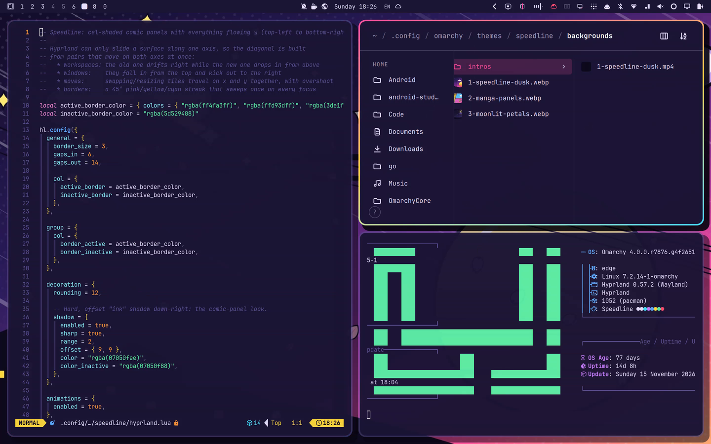
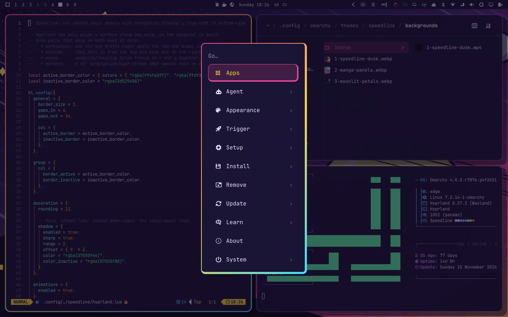
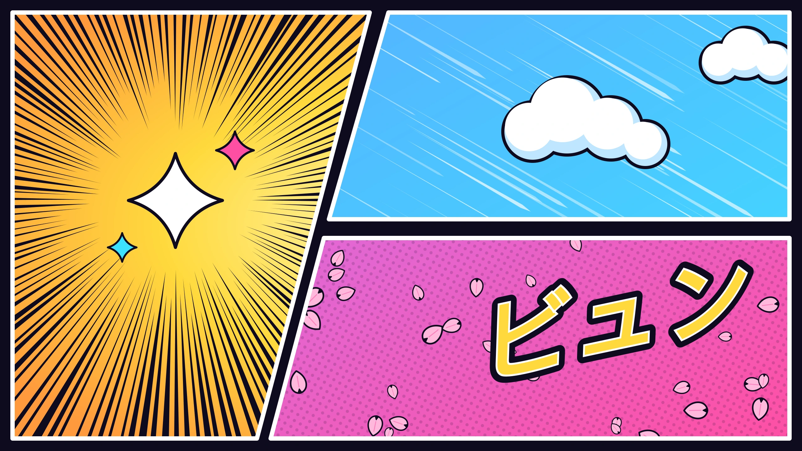

# Speedline

A theme for [Omarchy](https://omarchy.org) with comic-panel windows, sakura petals and speed lines. Windows and workspaces move diagonally, from the top left to the bottom right.



## Install

To get the full theme with the ink shadow and the animations, download it into your themes folder:

```sh
mkdir -p ~/.config/omarchy/themes/speedline
curl -fsSL https://github.com/bjarneo/omarchy-speedline-theme/archive/refs/heads/main.tar.gz \
  | tar -xz --strip-components=1 --exclude='*/screenshots' -C ~/.config/omarchy/themes/speedline
omarchy theme set speedline
```

`omarchy theme install` also works, but it installs less:

```sh
omarchy theme install https://github.com/bjarneo/omarchy-speedline-theme
```

Omarchy removes `hyprland.lua` from a theme that it clones, because Hyprland runs that file at login. You keep the colors, wallpapers, gradient borders and shell styles. You lose the ink shadow, the 3 px borders, the 12 px corners and the animations.

[`hyprland.lua`](hyprland.lua) only sets borders, shadows and animations. Read it before you install the full theme.

## What you get

| Part | Look |
|---|---|
| Colors | Ink indigo with sakura pink, star yellow and sky cyan. `colors.toml` styles the terminals, Neovim, btop, GTK, Qt and the bar. |
| Borders | A 3 px gradient from pink to yellow to cyan at 45°, with 12 px corners. |
| Shadow | A hard ink shadow, offset down and to the right like a comic panel. |
| Shell | The menu, launcher, notifications, popups, lock screen and polkit dialog get thin top and left edges and thick bottom and right edges. |
| Wallpapers | Dusk power lines with a 6.5-second intro video, manga panels and moonlit petals. |




## Animations

- **Workspaces:** The old workspace moves right while the new one drops in from the top. Together they make one diagonal wipe.
- **Windows:** New windows fall in from the top with a bounce. Closed windows leave to the right.
- **Tiles:** Swaps and resizes move on both axes at once, with overshoot.
- **Focus:** The border gradient sweeps once each time a window gets focus.
- **Notifications:** New notifications drop in from the top.

## Wallpapers

| Dusk | Manga panels | Moonlit petals |
|---|---|---|
|  |  |  |

To move to the next wallpaper, run this command:

```sh
omarchy theme bg next
```

Dusk plays its intro video when it becomes the wallpaper. To turn off intro videos, run this command:

```sh
omarchy theme bg intro disable
```

## Tune it

To make the animations calmer, edit `~/.config/omarchy/themes/speedline/hyprland.lua`:

- To reduce the bounce, lower the `cartoonPop` overshoot from `1.56` to `1.2`.
- To remove the ink shadow, set `shadow.enabled = false`.

Then apply the theme again:

```sh
omarchy theme set speedline
```

To turn off all animations, open **Appearance › Animations** in the Omarchy menu.

## Requirements

Speedline is made for Omarchy 4.5.
